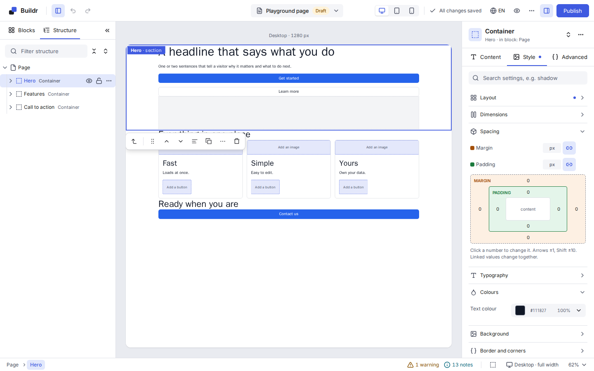
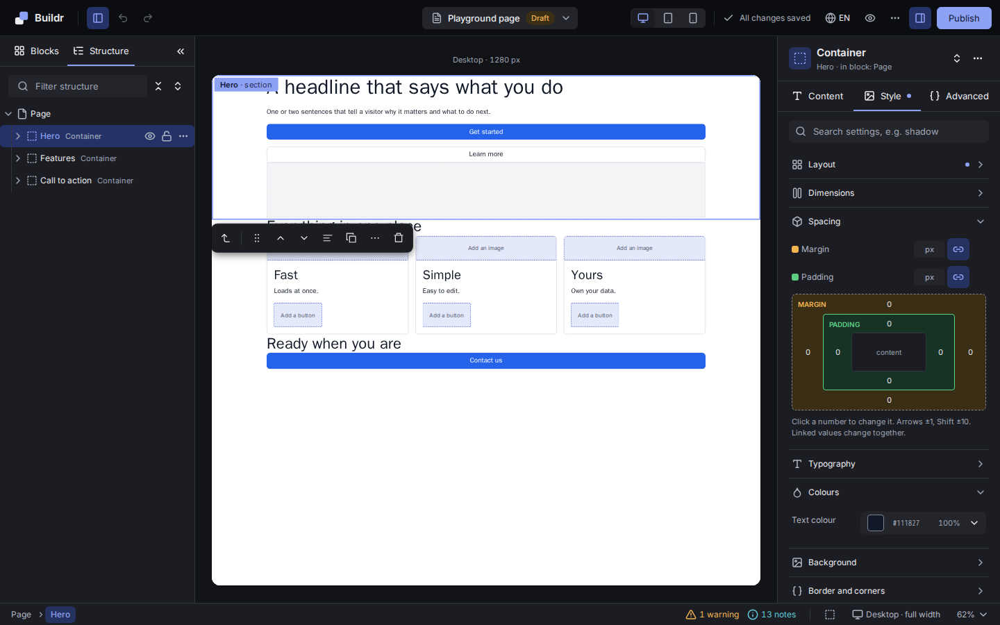

# Editor





*The screenshots are the visual baseline (`apps/playground/e2e/visual/editor`), regenerated in CI by the `visual` PR label, so they always show the current editor.*

See also [ADR-009](adr/ADR-009-editor-architecture.md) and [ADR-015](adr/ADR-015-iframe-preview.md).

## Layout and modules

```
Toolbar: <- CMS | Document title | Desktop/Tablet/Mobile | Undo Redo | * Saved | Preview | Publish
Insert / Layers panel | Canvas = iframe (width = breakpoint) | Inspector (Content / Style / Advanced)
Issues panel (validation + a11y + binding diagnostics), collapsible
```

```
packages/editor/src/
  app/           BuilderEditor (root), EditorConfig, providers, layout
  store/         slices (document, history, selection, viewport, ui, persistence, canvas), selectors, dispatch
  canvas-host/   iframe mounting, transport to the parent side, patch synchronization, status/errors
  panels/
    insert/      component and template palette from the manifest, search
    layers/      the document tree (virtualized)
    inspector/   props (per-kind controls), value modes (Static/Dynamic/Formula), styles, advanced, a11y
    issues/
  toolbar/
  dnd/           pointer-event engine, sources (palette, tree), iframe overlay, forwarding
  shortcuts/     scoped keyboard shortcut registry
  clipboard/
  persistence/   DocumentAdapter (types), autosave, conflict resolution
  ui/            UI primitives (Radix wrappers), editor tokens.css
```

**Mount API**:

```tsx
<BuilderEditor
  adapter={documentAdapter}          // DocumentAdapter: load/save/publish/media/dataSchema/session
  manifest={manifest}                // RegistryManifest (from the server, or from the registry directly in the playground)
  canvasUrl="/buildr/canvas"         // the canvas route (same-origin in MVP)
  documentRef={{ collection: 'pages', id: '123' }}
  config={{ breakpoints, shortcuts, autosave: { debounceMs: 2000, maxWaitMs: 20000 } }}
/>
```

## The shell (`@next-buildr/editor`, PB-073)

`<BuilderEditor adapter manifest canvasUrl documentRef config />` fills its container (give it a height) and renders the layout above: a toolbar, the left panel, the canvas and the inspector between two **resizable splitters**, and the collapsible issues bar. The panels are slots (`EditorLayout`'s `toolbar`, `left`, `center`, `right`, `issues`) that the following tasks fill; the props are already the final mount API. In the playground it is mounted at `/editor`.

- **Splitters** follow the WAI-ARIA window splitter pattern: `role="separator"` with `aria-valuenow/min/max`, dragged with a pointer or moved with the arrow keys (16 px), Home and End. The left panel is 200-480 px, the right one 240-520 px.
  Double-click puts a splitter back to its default width, and both widths are remembered in `localStorage` (`buildr:editor:left-width`, `buildr:editor:right-width`; every access in try/catch). The splitter is a 1px line with an 8px invisible hit area and shows the accent line on hover, focus and drag. While the panels sit beside the canvas it keeps at least 480px.
- **Canvas stage** (PB-124): the host is padded (`--bd-space-6`) and shows a width label above the page ("Tablet · 820px"). The iframe is scaled with `transform`, which does not change its layout box, so its height is the visible stage height divided by the scale (`stageMetrics` in `canvas-host/canvas-frame.tsx`): at 50% zoom the canvas shows twice the page height instead of an empty area. The page has a subtle shadow (`--bd-elevation-2`), scale and width changes animate with `--bd-duration-base` (0 with reduced motion), and the connecting and error screens are cards with an icon, a title and the detail list. Pointer coordinates (PB-086) use the frame's rect and are unaffected.
- **Status bar** (28px): the issues toggle (`aria-expanded`) with the error and warning counts from the issues store (`EditorLayout`'s `issueCounts`), and on the right the active breakpoint with its width, the canvas zoom and the save state (`status` slot; `StatusInfo` in `EditorApp`). The save state there is plain text; the toolbar's `SaveStatus` stays the live region.
- **Narrow editor**: below 1100px, measured on the editor root with a `ResizeObserver` (the editor may be embedded, so no media query), the side panels are hidden overlays. The toolbar renders `PanelToggle` buttons (`toolbar/panel-toggles.tsx`, driven by `ShellPanelsContext` from `app/shell-panels.tsx`) that open one at a time; Escape closes the open one.
- **Interface strings** are never written into components: every one is a key of the catalog in `messages/en.ts`, translated in `messages/pl.ts` (a missing Polish key is a type error), read with `useT()`. `config.uiLocale` picks the language (`en` or `pl`, English for any other); it is the language of the *editor*, not of the content (docs/i18n.md).
- **Theme**: tokens are CSS variables (`--bd-*`, see [editor-design.md](editor-design.md)) defined in `styles/tokens.css`, light and dark. The scheme follows the system's, or is forced with `data-theme="light" | "dark"` on the editor root (`system` or no attribute follows the system). Import `@next-buildr/editor/styles.css` once in the host; the published file is `styles/*.css` flattened in order, with Inter shipped in `fonts/` next to it (no external requests).
- **UI primitives** (`Button`, `IconButton`, `Input`, `Select`, `Tabs`, `Popover`, `Dialog`, `Tooltip`, `Toggle`) wrap Radix UI: keyboard, focus management and ARIA come from Radix, the looks from the tokens. An `IconButton` requires a `label` (its accessible name and tooltip).
- Every region is a landmark with a translated name (`role="toolbar"`, `aside`, `main`, `section`); the shell is checked with axe in the tests.

## Iframe vs. rendering inside the editor's own tree

| Criterion | Iframe (a real Next.js page route) | Rendering inside the editor's React tree |
|---|---|---|
| Production fidelity | Same renderer, the site's own global CSS, fonts, layout, providers | Site CSS would need loading into the editor, colliding with editor CSS |
| Media queries / responsive | Native (iframe width = viewport) | Media queries respond to the editor window, forcing a rewrite to container queries |
| CSS/JS isolation | Full (a separate document) | Style leakage in both directions, global reset conflicts |
| Custom client components | Behave exactly as on the site | Share a runtime with the editor — a broken component can crash the editor |
| Communication complexity | postMessage, async, a protocol | Direct calls, simpler |
| Overlays / drag-and-drop | An overlay drawn inside the iframe, palette drag forwarded in | Straightforward |
| Performance | Two React trees, patch serialization (cheap) | One tree |
| Security | Requires origin/source validation | No boundary to defend |

**Decision: iframe.** Fidelity, native media queries and isolation are non-negotiable for a builder targeting production client sites, and they are extremely expensive to fake without one. The protocol/overlay/drag-and-drop cost is one-time and well-testable. Document state lives **only** in the editor; the canvas keeps a read-only replica and every change always goes through a command dispatched in the editor.

## Canvas runtime (inside the iframe, `@next-buildr/react/canvas`)

- Handshake and document/patch ingestion. A local replica plus a small per-node-subscribable store.
- Rendering via `renderTree` with instrumentation: `NodeView` (memoized, per-node error boundary, `data-bid`/`data-bi` forwarded through `root`), empty-slot placeholders, unknown-component placeholders.
- Interaction capture in the capture phase: a click selects a node instead of navigating a link or submitting a form; hover highlights; a double-click enables inline editing; context menu requests are forwarded to the editor.
- An overlay (Shadow DOM, `position: fixed`, updated on `requestAnimationFrame` during scroll/resize): selection/hover outlines, a type label, a drag handle, an outline around every Loop instance. `ResizeObserver` only watches the selected and hovered elements.
- Selecting a node inside a collapsed `<details>` opens its `<details>` ancestors generically, with no per-component special-casing.
- Hit-testing for drag-and-drop (`elementsFromPoint`, following `data-bid` up to the root with rects and the layout axis) plus drawing the insertion indicator.
- Data: any `DataSource` (the `HttpDataSource` in the apps), fetched by `createDataPreparer` with a 300ms debounce and a cache keyed by what is asked for.
- Forwarding keyboard shortcuts (outside text fields) and reporting errors/diagnostics.

### How the canvas runtime works (PB-067)

`CanvasRuntime` is one component: give it the registry, the theme, the platform and the allowed editor origins, and it is the whole canvas page. Its parts:

- **Store** (`createCanvasStore`): the replica of the document and the rest of what the editor sent (selection, hover, viewport, mode, locale). It is subscribable as a whole and **per node**; the document is replaced only through `editor:init`, `doc:set` or `doc:patch` (`applyDocumentPatches`, which shares every node a patch did not touch, so a node's identity says whether it changed).
- **Handshake**: `canvas:hello` is sent every 500 ms (40 times at most) until `editor:init` arrives; `canvas:ready` follows the first commit that has the data of the document. Each further `editor:init` is answered the same way.
- **Versions**: a `doc:patch` is applied only when its `from` is the version the canvas has. A newer `from` (a message was lost) or a patch that does not fit the document sends `doc:resync-request { have }` **once**, and later patches are ignored until the editor answers with `doc:set`. A patch to a version the canvas already has is dropped.
- **Rendering**: `renderNodeAt` with `instrument.lazyChild` (docs/renderer.md#the-canvas-renders-node-by-node). Each node is a `NodeView`: memoized, subscribed to its own node, wrapped in its own error boundary. Editing one prop re-renders that node's component and nothing else; inserting a node re-renders its parent and the new node.
- **Placeholders**: a component that throws is replaced by a `[data-buildr-placeholder="error"]` element that keeps `data-bid` (so it can still be selected and deleted) and reported as a non-fatal `canvas:error` with its `nodeId`; it renders again as soon as its node changes. An unregistered component shows `[data-buildr-placeholder="unknown"]` with its type, and an empty slot (in edit mode) shows the text from the component's `editor.emptySlotText` — the canvas has no strings of its own.
- **Diagnostics**: what each node's render reports is kept per node and sent as one `diagnostics` message (coalesced, and only when it changed). `window.onerror` and `unhandledrejection` are sent as `canvas:error`.
- **Data**: `prepareRender` runs when the document is replaced (`editor:init`, `doc:set`) and when the context or locale changes. It does not run for a patch: debouncing and caching by query spec is PB-071.
- The channel is `connect()` (a `createChildTransport` on the canvas's own window by default; `session` comes from `?session=`). The runtime owns it and closes it on unmount.

### Selection, hover and the overlay (PB-068)

`CanvasRuntime` installs both by default (`interactive={false}` turns them off):

- **Capture** (`installInteractions`): capture-phase listeners on the document. In `edit` mode a primary-button click is stopped (`preventDefault`, `stopPropagation`, `stopImmediatePropagation`) whether or not it is on a node, so no link navigates and no button runs the site's handler; on a node it sends `node:click` with the node's `data-bid`, the Loop repetition (`instance`: the `data-bi` indices from the outermost loop, joined with `.`) and the modifier keys. `dblclick` sends `node:dblclick`; `mouseover` sends `node:hover` once per change of node (`null` when the pointer leaves the page); a `submit` is cancelled. In `interact` mode nothing is captured.
- **Overlay** (`createOverlay`): a `position: fixed`, `pointer-events: none` host with a shadow root, appended to `<body>`, so the site's CSS does not reach it and it takes no part in the site's layout. It outlines the selected nodes (solid, with the node type as a label) and the hovered one; a node rendered once per Loop repetition is outlined once per repetition, the first solid and the rest dashed. Boxes are read with `getBoundingClientRect` (viewport-relative, so fixed and sticky elements are right) and redrawn on the next animation frame after a scroll, a resize, or a change of selection, hover or document; a `ResizeObserver` watches only the outlined elements.
- **Overlay look (PB-130)**: 1px hover and 2px selection outlines in the editor accent; a label chip with the component label and the node name (`Container · Hero`) that flips inside the node when it would leave the viewport (`overlay/chip.ts`, pure); drop feedback is an accent line with end caps, an accent-tinted highlight for "inside", and a danger tint with the reason when forbidden; empty-slot placeholders (`editor.emptySlotText`) have a dashed accent outline. The colours are a fixed set of `--buildr-*` variables (`overlay/palette.ts`) mirroring `--bd-accent`; the canvas is a separate document, so they are not themed from the editor (that needs a protocol change and is a later card).
- Selecting a node inside a collapsed `<details>` opens its `<details>` ancestors, for any component.
- Outside production, a selected node with no `data-bid` element logs one warning: it cannot be outlined.

### Inline editing (PB-069)

A double click on a component whose `editor.inlineProp` names a prop holding a **static, non-localized string** makes the component's root element editable in place (`installInlineEdit`; `contenteditable="plaintext-only"`, or `true` plus pasting as plain text where the browser has no `plaintext-only`). The double click still reaches the editor as `node:dblclick`.

- **Enter** (without Shift) or **leaving the element** sends `inline:commit { id, prop, value }` — once, and only when the text changed; the editor turns it into one `node.setProp` and so one history entry. **Escape** puts the old text back and sends nothing. Text over 20 000 characters is not sent.
- The node's view is **frozen** for the session (`store.beginEdit`): typing re-renders nothing, so the caret never moves, and a patch that arrives mid-edit reaches the replica but is not shown until the session ends (then the latest state is).
- A click inside the text being edited places the caret and is not reported as a selection. Nothing is editable in `interact` mode, for a bound or localized value, or for a component with no `inlineProp`.

### Drag and drop in the canvas (PB-070)

`createDndController` (`@next-buildr/react/canvas`) is the canvas half of docs/drag-and-drop.md:

- **`buildHitPath(document, point, store)`** finds the nodes under a point with `elementsFromPoint`, follows `data-bid` up to the root and returns one `HitEntry` per node, deepest first: its box, its layout axis (`display`/`flex-direction` from the computed style: a flex row is `x`, a flex column and block flow are `y`, grid is `grid`), the boxes of its children in slot order (a Loop's first repetition only) and the boxes of its empty-slot placeholders. Coordinates are the canvas viewport's.
- **`dnd:over`** (an item dragged in from the palette or the layers panel) runs `computeDropTarget` and draws the result in the overlay: a 2px line, a highlighted container for an empty slot, or, when nothing accepts the item, a red box on the node under the pointer carrying the refusal's message. It answers `dnd:target { target, reason? }` — once per change, although the editor sends `dnd:over` every frame. `dnd:leave` clears the indicator. Nothing happens in `interact` mode.
- **Moving inside the canvas**: the selected node (never the root) has a handle in the overlay. Pressing it captures the pointer, shows the same indicator for `{ kind: 'nodes', ids }`, autoscrolls within 48px of the top or bottom edge, and on release sends `intent:move { ids, target }` when there is a target; Escape or a release over a refused spot sends nothing.

### Data in the canvas (PB-071)

The runtime takes any `DataSource` (`dataSource`), and `createDataPreparer` decides when `prepareRender` runs:

- **Replaced document or new context** (`editor:init`, `doc:set`, `context:set`, `locale:set`): fetched at once, nothing cached is reused. `context:set`/`locale:set` also call the optional `loadScopes(contextRef, locale)`, whose result becomes `DataContext.scopes` (`page`, `route`, ...); `ctx.locale` switches with the locale.
- **A patch**: `dataKey` — the static media refs and query specs of every node, the aliases of the Loops around them, the locale, the mode and the scopes — is compared with the last one. **Unchanged (an edit to text, styles, order): no request at all.** Changed: the request waits for 300 ms without a further change (`DEFAULT_DATA_DEBOUNCE_MS`), and a key seen before (the last 8) is answered from the cache immediately.
- **While it loads** the canvas keeps rendering the last data and `store.getState().dataLoading` is `true`; only the answer to the latest request is shown. A failing source becomes diagnostics (`data.source-error`, `canvas.data-failed`, `canvas.context-failed`) and the document renders without that data.

### Shortcut and context-menu forwarding (PB-072)

While the focus is inside the iframe the editor would not see the keyboard, so `installForwarding` sends it what it handles:

- **`key:down { key, code, mods }`** for Ctrl/Cmd + Z, Y, C, X, V, D, A or S, Ctrl/Cmd+1/2/3/., Ctrl/Cmd+Shift+O, Enter and ? (only on the body or selection root; overlay controls retain native activation), Delete, Backspace, Escape and Alt + Up/Down. A forwarded key gets `preventDefault`, so the browser does not also act on it (Ctrl+Z is not the browser's undo, Ctrl+S does not save the page); a held key is sent once. The list stays clear of the browser's own shortcuts (Ctrl+R/W/T/L/F/P, F5, F12 …), which are never captured.
- **Never from a text field or from text being edited in place** (`input`, `textarea`, `select`, `contenteditable`, an inline-edit session): there the keys belong to the text. Nothing is forwarded in `interact` mode.
- **`contextmenu { id, point }`** on a right click: the node under it (or `null`) and the pointer's position in the canvas viewport (the editor adds the iframe's offset and zoom); the browser's menu does not open, except in a text field or text being edited.

### Selection, hover and breadcrumbs (PB-075)

The selection lives in the editor store (`selectedIds`, `anchorId`, `selectedInstance`, `hoveredId`); the canvas reports clicks and hovers, the host turns them into `store.select(id, { mode, instance })` (`replace`; `toggle` with Ctrl/Cmd; `add` with Shift) and `store.setHovered(id)`. The anchor is the last node selected: the inspector shows it and keyboard moves start from it. `store.moveSelection('parent' | 'child' | 'next' | 'previous')` steps through the tree (siblings across all slots, no wrapping) and returns the node now selected. After every change to the document, undo, redo or a replacement, nodes that no longer exist drop out of the selection and the hover, and the anchor moves to the last one left. `<Breadcrumbs />` lists the path from the root to the anchor; a button selects its node and hovering it highlights that node on the canvas.

### The canvas host (PB-076)

`packages/editor/src/canvas-host`. `createCanvasHost({ store, transport, manifestHash, locales, breakpoints, … })` is the editor's end of the channel; `<CanvasFrame canvasUrl manifestHash locales breakpoints />` creates the iframe (`?session=` is a fresh 128-bit nonce), the `createParentTransport` for it and the host, and shows the status screens. The host holds no document: the store is the truth.

- **Handshake.** Every `canvas:hello` is answered with `editor:init` built from the store as it is then (document, version, selection, viewport, locale, context, mode), so `editor:init` is idempotent and a canvas that reloads or crashes is rebuilt without loss. The hello's `manifestHash` must equal the editor's and its protocol version must be ours; otherwise the status is `error` (`manifest` or `protocol`, with both values shown) and nothing is sent. No hello within 10 s is a `timeout` error that names the usual causes (URL, `frame-ancestors`, allowed origins). A fatal `canvas:error` is an error too. "Reload canvas" mounts a new frame with a new session.
- **Changes to the canvas.** Store changes are queued and sent once per animation frame as one `doc:patch` (`from` of the first to `to` of the last); a replacement, or more than `MAX_PATCHES` patches, is sent as `doc:set`, and so is the answer to `doc:resync-request`. Nothing is sent to a canvas that is not `initializing` or `ready`; its `editor:init` carries whatever it missed. Selection and hover go out at once, and only when they changed.
- **Viewport, zoom, locale, context, mode.** `setBreakpoint`, `setZoom` (`'fit'` scales the frame down to the room there is, or a number), `setLocale`, `setContextRef`, `setMode` update the host's state and inform the canvas. `dndOver`, `dndLeave` and `scrollTo` forward to the canvas for the drag-and-drop engine (PB-086).
- **From the canvas.** `node:click` → `store.select` (Shift adds, Ctrl/Cmd toggles); `node:hover` → `setHovered`; `inline:commit` → `node.setProp` (into `l10n[locale]` when the editing locale is not the default); `intent:move` → `node.move`; a refused command goes to `onCommandError`. `key:down`, `contextmenu`, `node:dblclick` and `dnd:target` go to callbacks for the shortcuts, menus and dnd tasks; `diagnostics` is kept in the host's state.

`BuilderEditor` does not mount the frame yet: it needs the document the persistence task (PB-087) loads.

### The inspector (PB-079)

`<Inspector locale? defaultLocale? renderStyle? />` (`packages/editor/src/panels/inspector`) edits the node the selection is centred on. Its header names the component (from the manifest); with nothing selected it says so; a node locked for content, or a read-only document, disables every control.

- **Tabs.** *Content* lists the component's props (`PropsPanel`), grouped by `PropDef.group`; *Style* renders `renderStyle(node)` (the style inspector, PB-082) or a pointer to it; *Advanced* has the node's `name` and `anchor` (`node.setAttr`, cleared with an empty field; an anchor the command refuses stays on screen with the reason in the status line), a display condition to remove, and the props in the `advanced` or `accessibility` group.
- **Controls** (`inspector/controls`): text and textarea (`maxLength`), number (a draft that is written only when it is a finite number inside `min`/`max`; leaving the field shows the stored value), boolean (a checkbox), select (options may be numbers), link and icon (free text; the picker comes with the icon library). Every control gets its accessible name from the prop's label (or its name split into words) and is described by a hint with the default and the limits. Rich text, list and object are described below (PB-080); other kinds (media) say they cannot be edited here yet.
- **Writing.** A control dispatches `node.setProp` with a static value; the command's merge key folds a run of typing into one undo step. "Reset" (shown only when the node carries a value) dispatches `node.unsetProp` and the default shows again.
- **Languages.** With `locale` different from `defaultLocale`, a translatable prop shows that language's translation (falling back to the default-language value) and writes to `l10n[locale]`; a prop with no fixed value yet first gets its default, in the same undo step. Reset removes only the translation.
- **Layout (PB-127).** The header shows the component icon, its label, icon buttons to duplicate and delete the selection (the same `node.duplicate` / `node.remove` commands as the layers) and an input for the node's `name`. The three tabs share the width. Prop groups are collapsible sections; the closed groups are remembered per component type in `localStorage` (`buildr.editor.inspector.groups.<type>`, best effort). A field is a grid: boolean, select, number and icon put the control beside the label (`data-layout="row"`), everything else stacks it under the label (`data-layout="stack"`); the value-mode switch shares the label row of stacked fields. "Reset" is an icon button shown on hover or focus of the field. Empty states: nothing selected (icon and a hint to click the canvas or press Enter) and no properties.
- **Dynamic values.** A binding or a formula shows as a chip ("Bound to data: post.title") instead of a control; picking and editing them is PB-081.

### Rich text, list and object controls (PB-080)

`controls/compound.tsx` holds `renderControl(def, props)`, the one place that picks the control for a prop kind; lists and objects call it again for their items and fields, so they nest to any depth.

- **Rich text** (`RichTextControl`; the editable area sits in its own `.bd-rich-body` block, as Lexical warns about a contenteditable directly inside a flex container, PB-157). A small Lexical editor (`lexical`, `@lexical/rich-text`, `list`, `link`, `selection`; the editor is its own route, so the weight stays out of site bundles) with a toolbar: heading 2 to 4, bold, italic, link, bulleted and numbered list, each with `aria-pressed`. The field is a `role="textbox"`. Content goes in through `$loadRichText` and out through `serializeRichText`, which walks the editor state into core's `normalizeRichText` and then checks `richTextSchema`; a state that fails the schema is never written, so the stored value always conforms. An editor holding one empty paragraph is saved as an empty document. Link addresses go through `sanitizeUrl`; an unsafe one is refused in the toolbar. A value that changes elsewhere (undo) is loaded; a value the editor itself wrote is not reloaded.
- **List** (`ListControl`). Items are edited with the control of `def.of`; add (up to `max`, a new item is a copy of the item default), remove (down to `min`) and move up/down, each button named with the item's number. A value that is not an array is an empty list. Every change writes the whole list.
- **Object** (`ObjectControl`). One labelled control per field of `def.fields`, showing the field default where the object has no value; a change writes the whole object.

### The style inspector (PB-082)

`<StyleInspector node breakpoint? theme? />` (`panels/inspector/styles`) is what `Inspector`'s `renderStyle` slot takes. It lists the style groups the component allows (`styles.groups`), each property from core's property registry, and edits them at `breakpoint` (`'base'`/desktop by default, else a breakpoint id of the theme; an id the theme lacks disables editing).

- **Nothing outside the grammar is written.** Typed text goes through `checkStyleInput`: numeric text becomes a number where the grammar takes one, then `parseStyleValue` must accept it and every `$scale.name` token must exist in the theme; otherwise the field is `aria-invalid`, shows the reason and dispatches nothing. Pure enumerations are a select of their keywords; `visibility.hidden` is a checkbox; box (margin, padding, inset, border width) and corner (radius) properties get one field per side/corner. Tokens and keywords are offered as suggestions.
- **Writing.** `node.setStyle` with `layer: {}` (desktop) or `{ bp }`; typing coalesces through the command's merge key. An emptied field or "Reset" dispatches `node.unsetStyle` for this layer only.
- **Sources.** `effectiveStyles` gives each value and the layer it comes from; one inherited from a wider breakpoint is labelled "from desktop"/"from tablet" and a reset button appears only where this layer sets the value. Groups holding a value start open.
- **Controls (PB-128).** Each control only changes how a value is entered; it writes the same `node.setStyle` / `node.unsetStyle` as the plain field it replaced, and the text still goes through `checkStyleInput`, so a value outside the grammar stays unrepresentable.
  - `NumberUnitInput` (`ui/primitives.tsx`): ArrowUp/ArrowDown step by 1 (Shift x10, Alt /10; 0.1 for a number confined to a small range such as opacity) and the unit is a menu (a native select) that offers only the units of the property's grammar, so nobody types `px`: the field holds the number, digits keep the unit, a keyword or token switches the field to text and disables the menu. Stepping is typing, so a run of steps coalesces into one undo step through the merge key.
  - **Sides and corners** (`sides-editor.tsx`): margin and padding are drawn as nested rings (margin around padding), inset, border width and radius as a row. Every side is its own number field; the link button (on while the values are equal) moves all sides together as one undo step (`store.transaction`), one unit menu re-units every set side, and the token picker fills the linked sides or the last focused one.
  - **Layout of the tab**: pairs such as width/height, row gap/column gap, font size/weight share a row (`PAIRS` in `segments.ts`); display, direction, alignment, text align/transform/style/decoration are icon or text segments; colours have a native picker over the swatch (`ColorInput`, hex only, checked with the grammar); a number confined to a range of one (opacity) also has a slider.
  - **Tokens**: a "Tokens" picker lists the theme's tokens the property accepts, with a swatch for colours (`ColorSwatch`, painted only for a colour notation) and the value for spacing and fonts; it writes the `$scale.name` reference.
  - **Segments**: direction, align, justify and text-align are a `SegmentedControl` of icons (`styles/segments.ts`); a keyword without a segment stays reachable in the "Other values" menu. Pressing the active segment resets it.
  - **Origin dot** beside each property: filled = set on this breakpoint, amber = inherited from a wider one, hollow = default; Reset removes this layer's key only.
- The active breakpoint comes from the toolbar (PB-083); styles locks disable the fields.

### Keyboard shortcuts (PB-084)

`<ShortcutProvider overrides? actions? platform?>` (`packages/editor/src/shortcuts`) must sit inside the store provider. It makes one registry (`createShortcutRegistry`; nothing global), binds the store's actions to it, listens for `keydown` on the document and shows a help dialog on `?`.

- **Map** (`DEFAULT_SHORTCUTS`, by action id): `edit.undo` Mod+Z · `edit.redo` Mod+Shift+Z / Mod+Y · `edit.copy|cut|paste` Mod+C/X/V · `edit.duplicate` Mod+D · `edit.delete` Delete / Backspace · `node.moveUp|moveDown` Alt+↑/↓ · `selection.all` Mod+A (the anchor's siblings) · `selection.clear` Esc · `file.save` Mod+S · `help.shortcuts` ?. **Mod** is Cmd on a Mac and Ctrl elsewhere. `config.shortcuts` overrides by action id (`{ 'edit.duplicate': 'mod+j' }`; an empty string turns one off). Combinations are canonical text (`mod+shift+z`, `normalizeCombo`).
- **Actions.** Undo, redo, duplicate (`node.duplicate`), delete (`node.remove`), move (`node.move` past the neighbour), select siblings and clear act on the store; the root is never removed or moved. Copy, cut, paste (PB-085) and save (PB-087) come in through `actions`. A handler that could not act returns `false`, so the key is not swallowed; a handled key gets `preventDefault`.
- **Never while typing.** Nothing runs when the focus is in an input, textarea, select or editable region (`isTypingTarget`; checkboxes and buttons do not count as text). Keys forwarded from the canvas (`key:down`, PB-072) already exclude text there; `useForwardedKeys()` returns the function for the canvas host's `onKeyDown`.
- **Scopes.** `bind(action, handler, scope = 'editor')` and `setScopes([...])`: only bindings of an active scope fire, the latest first, so a dialog can take a key from the editor. The help dialog narrows the scope to `dialog` while it is open.

### The insert panel (PB-078)

`<InsertPanel />` (`packages/editor/src/panels/insert`) is the palette. It reads the manifest (`<ManifestProvider>`) and lists the components that may be inserted (not `root`, not `insertable: false`) and the templates, each grouped by category and sorted by label. The `ui` and `cms` categories are named "UI" and "CMS" and the built-in category headings come from the `messages` catalog. A component inserted from the panel (or dragged in) is stamped with the registry's component versions. Search matches every word against label, type, description and keywords (templates: label, id, category). Every entry is a real button, so the palette works with the keyboard alone and without drag and drop.

- **Layout (PB-125).** A sticky bar holds the search field (search icon, clear button; `/` focuses it unless a text field or editable region has focus) and the grid / list toggle, remembered in `localStorage` (`buildr.editor.insert.view`). Components are compact tiles, three per row, two when the panel is narrower than about 220px of content (a container query on the panel, so an embedded editor needs no viewport media query); templates use fixed 16:10 thumbnails and show a skeleton while the manifest is missing. Categories collapse (`aria-expanded`, with an item count; a search expands all of them), descriptions are tooltips (list view also shows them inline), tiles have the `grab` cursor, and a search with no result shows an empty state.

- **Where it goes.** `placeInsertion(doc, registry, selectedId, what)` picks the first position `canInsert` accepts: at the end of the first slot of the selected node that takes it, else right after the selection, else after each ancestor in turn; with nothing selected, inside the root. The result is a position `node.insert` will accept, so a click is one `node.insert` command (one undo step) and the new node becomes the selection.
- **When it cannot.** Nothing is changed; the status line says "It cannot be inserted here." followed by the rule's own message (for example a slot's `max`). A read-only document says so instead.
- **Templates** are instantiated with `instantiateTemplate` (detached copies that remember their `source`). A template's `thumbnail` is shown only when it is an `http(s):` or root-relative address or a raster `data:image/` URL; anything else shows a placeholder icon in the same 16:10 frame.
- `EditorStore.registry` exposes the registry the commands run against.

### The layers panel (PB-077)

`<LayersPanel wrapperType? />` (`packages/editor/src/panels/layers`) shows the document as a WAI-ARIA tree. It reads the store and the manifest (`<ManifestProvider manifest>`; without one the rows show the component's type) and changes the document only by dispatching commands.

- **Rows.** `flattenTree(doc, expanded)` lists the visible rows (iteratively, and safe against a corrupt document that reaches a node twice); each has its ARIA level, position and set size. The label is the node's `name`, else the component's label, else its type; children in a slot other than `default` show the slot's name. The icon is a placeholder initial until the manifest's icon names have a set to map to (`data-icon` carries the name).
- **Virtualization.** Every row is 28 px, so only the rows in view (plus a few) exist; the scroll height is that of all of them. 1000 nodes flatten in well under 50 ms.
- **Keyboard.** Focus stays on the tree and `aria-activedescendant` names the active row, which is the anchor of the selection: Up/Down/Home/End move it (Shift adds to the selection), Right expands or goes to the first child, Left collapses or goes to the parent, Enter/Space select, F2 renames, Delete/Backspace remove the selection, the menu key opens the context menu. Nothing here needs a pointer.
- **Selection and hover.** Click selects (Shift adds, Ctrl/Cmd toggles), the arrow toggles a row without selecting it, pointer hover sets `hoveredId` (which the canvas shows) and a hover set elsewhere marks the row. A node selected in the canvas opens its ancestors and scrolls into view; an edit elsewhere never moves the list.
- **Rename** (F2 or double click) dispatches `node.setAttr` (`name`; empty clears it), once, whether ended by Enter, Escape or leaving the field.
- **Badges** (each with an accessible name): lock, `visibleIf`, styles for other breakpoints, and a validation or accessibility issue on the node.
- **Lock.** Locking a layer sets `lock` (structure, content, style) on the block. Core checks the structure lock from a node's parent on, so the editor adds its own guard (`isNodeStructureLocked`: the block itself or any block above it, not past an editable `region`): a locked block is not deleted, cut, duplicated, wrapped, unwrapped or moved from Delete, Alt+Arrow, Ctrl/Cmd+D, the menus, the inspector, the canvas toolbar and drag, or the layers drag and Move to. The attempt changes nothing and shows the info toast "This block is locked. Unlock it in the Structure panel."
- **Look (PB-126).** The row height is one constant (`ROW_HEIGHT`, 28 px) that the virtualizer uses and that is handed to CSS as `--layer-row` (with `--layer-indent` and `--layer-pad`), so the two cannot drift apart. Indent guides are hairlines drawn as a background per ancestor level; selection is `--bd-surface-selected` with a 2px accent bar; the slot name is a muted suffix after the label; badges are icons with tooltips; on hover or selection a `more` button at the right opens the same context menu as a right click (it dispatches a `contextmenu` event, no new command).
- **Context menu**: rename, duplicate, wrap in container (`wrapperType`, `buildr/box` by default, only when the manifest has it), unwrap, delete. It acts on the row it opened on (selecting it first when it was not selected). A command the rules refuse shows its message in the panel's status line; a read-only document disables all of it.
- **Filter and expand all (PB-157).** A search field above the tree keeps the blocks whose name, label or type contains the text (case-insensitive) and every ancestor of one, shown expanded (`filterTree`); with no match the panel says so (`structure.noMatch`). The down arrow moves from the field into the tree. Two icon buttons collapse the tree to the page root and expand every block that has children; both are off while a filter is active, and while it is active a row toggle only changes the unfiltered open state.

## The postMessage protocol

An **envelope**, Zod-validated on both sides (malformed messages are dropped and logged in dev):

```ts
interface Envelope<T extends string, P> {
  source: 'buildr'; protocol: 2; session: string;   // session: a random nonce from the canvas URL, confirmed at handshake
  id?: string; replyTo?: string;                    // request/response
  type: T; payload: P;
}
```

**Handshake**: the editor creates `iframe src="{canvasUrl}?session={nonce}"` and waits up to 10s; the canvas posts `canvas:hello { protocol, rendererVersion, manifestHash }` to `window.parent` with an explicit `targetOrigin` (never `'*'`); the editor checks `event.origin`, `event.source === iframe.contentWindow`, the session and the protocol version, then compares `manifestHash`; the editor sends `editor:init { doc, docVersion, selection, viewport, contextRef, locale, locales, mode }`; the canvas renders and replies `canvas:ready`. A timeout or mismatch shows a diagnostic error screen (wrong URL, `frame-ancestors` CSP, origin, version).

| Direction | Type | Payload | Notes |
|---|---|---|---|
| E->C | `editor:init` | doc, docVersion, selection, viewport, contextRef, locale, locales | idempotent (safe on canvas reload) |
| E->C | `doc:patch` | `{ from, to, patches }` | Immer patches; a version gap triggers `doc:resync-request` |
| E->C | `doc:set` | `{ doc, docVersion }` | full document (init, resync, conflict resolution) |
| E->C | `selection:set` / `hover:set` | `{ ids }` / `{ id \| null }` | |
| E->C | `viewport:set` | `{ breakpoint, width }` | the iframe resizes itself; this message just informs editor-side logic |
| E->C | `context:set` | `{ contextRef }` | switching sample data for a template |
| E->C | `locale:set` | `{ locale }` | switch the content language |
| E->C | `dnd:over` / `dnd:leave` | `{ point, item }` | forwarding a palette/tree drag |
| E->C | `scroll:to` | `{ id }` | |
| E->C | `mode:set` | `{ mode: 'edit' \| 'interact' }` | `interact` lets clicks reach components (v0.2) |
| E->C | `view:set` | `{ outlines?, hidden?, theme?, labels?, typeLabels?, scale? }` | partial overlay state, never document data |
| E->C | `ping` | `{}` | request with an envelope `id` |
| C->E | `canvas:hello` / `canvas:ready` | | |
| C->E | `doc:resync-request` | `{ have: docVersion }` | the editor replies with `doc:set` |
| C->E | `node:click` / `node:hover` / `node:dblclick` | `{ id, instance?, modifiers }` | |
| C->E | `inline:commit` | `{ id, prop, value }` | -> `node.setProp` |
| C->E | `dnd:target` | `{ target \| null, reason? }` | reply to `dnd:over` |
| C->E | `intent:move` | `{ ids, target }` | drag started inside the canvas |
| C->E | `intent:action` | `{ id, action, value?, point? }` | block toolbar intent; `value` required only for `align` |
| C->E | `intent:insert` | `{ target: { parentId, slot, index }, point? }` | open the editor insert palette at this gap |
| C->E | `pong` | `{}` | reply with the ping's `id` in envelope `replyTo` |
| C->E | `key:down` | `{ key, code, mods }` | shortcuts |
| C->E | `contextmenu` | `{ id, point }` | point translated to editor coordinates |
| C->E | `diagnostics` | `{ items: Diagnostic[] }` | bindings, per-node render errors |
| C->E | `canvas:error` | `{ message, nodeId?, fatal }` | fatal shows a "Reload canvas" affordance (lossless) |

### Schemas (`@next-buildr/core/protocol`)

Every message of the table above has a Zod schema (`editorMessageSchema` for what the editor sends, `canvasMessageSchema` for what the canvas sends, `messageSchema` for both), and a test keeps this table and the schemas identical. All schemas are strict (an unknown field refuses the message).

- `parseEditorMessage`, `parseCanvasMessage`, `parseMessage` take whatever arrived in a `MessageEvent` and return a `Result`; a refused message is one `protocol.invalid-message` diagnostic and is never thrown. `parseEnvelope` reads just the envelope, and accepts any protocol version so that a `canvas:hello` of another version can be told apart from noise.
- `createMessage(type, payload, { session, id?, replyTo? })` builds a typed message. `MESSAGE_DIRECTION` says which side sends each type, so a receiver drops a type its peer may not send.
- `PROTOCOL_VERSION` is 2 and is in every envelope and `canvas:hello`. Update editor and canvas (`@next-buildr/react`) together. A v1 envelope is rejected through the existing `onReject({ reason: 'version', protocol: 1 })` path, so the editor shows its protocol-mismatch error; there is no v1 fallback. Changing the shape or meaning of any message bumps it in the same change.
- The session is 16 to 128 URL-safe characters; `id` and `replyTo` are 1 to 64.
- `doc:patch` carries Immer patches with JSON values only, at most 10 000 patches of at most 24 path segments, and no path segment may be `__proto__`, `constructor` or `prototype`. Its `to` must be later than `from`. `doc:set` and `editor:init` carry a document that must pass `documentSchema` (the canvas still runs the document limits on it).
- Other limits: 1000 ids in a selection or a move, 500 diagnostics, 20 000 characters of inline text, a viewport width of 240 to 4096, a prop name of letters, digits and `_` (never a prototype key).

### Overlay view and intents (protocol v2, PB-157)

`view:set` is ephemeral editor-owned overlay state: `outlines?: boolean`, `hidden?: NodeId[]` (at most 10 000 valid node ids), `theme?: 'light' | 'dark'`, and `labels?`. All fields are optional; omitted fields retain their previous values. A supplied `hidden` array replaces the previous list (`[]` clears it); hidden-in-editor nodes remain in the document and production rendering. The theme selects the overlay palette only. These fields never change component props or document styles.

`labels` is a strict, partial object with only these keys (14 with `selectParentOf`): `toolbar`, `selectParent`, `drag`, `moveUp`, `moveDown`, `duplicate`, `remove`, `align`, `alignLeft`, `alignCenter`, `alignRight`, `more`, `insert`, plus `selectParentOf` (a template with a `{name}` placeholder, the parent button's accessible name; the canvas replaces `{name}` with the parent's name as text). Each supplied label is 1–40 characters, contains non-whitespace text, and rejects angle brackets, Unicode control/format characters and line/paragraph separators. Labels are literal text for tooltips and accessible names, never HTML or CSS; consumers must use text/ARIA APIs. Omitted keys retain their previous translations; the editor supplies all labels before showing the toolbar. `{}` is a valid no-op update.

`typeLabels?: Record<typeId, string>` carries the editor's localized component names for the selection chip ("Nagłówek · h1": the type part only, the HTML tag stays) and the toolbar's parent button. Keys are component type ids (`ns/name`, at most 64 characters), at most 128 entries, values follow the label rules above (1–40 characters of plain text). It is optional and additive: a canvas without it falls back to the registry's own labels, and a supplied map replaces the previous one. `scale?: number` (0.1–4) is the scale the editor applies to the canvas frame; the overlay draws the block toolbar at its inverse so it keeps a constant on-screen size, and clamps its placement in the frame's own pixels at any scale. The status readout, the device label above the canvas and the canvas share one string (`toolbar.device.size`).

`intent:action` carries a valid node `id` and `action: 'selectParent' | 'moveUp' | 'moveDown' | 'duplicate' | 'remove' | 'align' | 'more'`. Only `align` requires `value: 'left' | 'center' | 'right'`; every other action forbids `value`. `intent:insert` reuses the strict drop target `{ parentId, slot, index }`: slot is a lower-case-leading alphanumeric name of at most 64 characters; index is the integer gap among the current children, 0–1 000 000. Both intents accept an optional strict `point: { x, y }`, finite client coordinates in the canvas viewport within ±1 000 000; the host translates them to editor coordinates for menus/popovers. `key:down` retains its existing `{ key, code, mods }` shape.

The canvas only requests actions. The editor validates node existence, permissions, locks and applicable rules against its current document before dispatching commands through `@next-buildr/core/commands`; select-parent and menu/palette requests only change editor UI state. A stale or refused target never changes the document. The canvas never executes a mutating command in response to these intents.

**Heartbeat policy for consumers:** after `canvas:ready`, the editor should send a `ping` request every 5 seconds, with at most one outstanding request, and require a correlated `pong` within 5 seconds. The canvas replies using `reply(pingMessage, 'pong', {})`; the envelope provides correlation, so neither payload needs a timestamp or nonce. The host must check the response type is `pong` (the generic transport correlates ids, not response types). A timeout drives the editor's connection-lost state; reload starts a fresh session and handshake. Stop heartbeat requests and timers on disconnect/disposal. Core defines and validates the message shapes only; scheduling and connection-state handling belong to the editor/canvas consumers.

### Transports (`@next-buildr/core/protocol`)

`createParentTransport({ iframe, canvasOrigin, session, host? })` is the editor's end and `createChildTransport({ allowedOrigins, session, host?, parent? })` the canvas's. Windows are passed in as small interfaces (`WindowLike`, `PostTarget`, `FrameLike`); `host` and `parent` default to `window` and `window.parent`, so `@next-buildr/core` itself has no DOM types. Both return a `Transport`:

- `send(type, payload)` returns `false` when there is no window to send to. `request(type, payload, { timeoutMs })` resolves with the answer (matched by `id` and `replyTo`) or rejects with a `TransportError` (`timeout` after 5 s by default, or `closed`). `reply(message, type, payload)` answers a request. `on(type, handler)` returns the function that removes it. `close()` stops listening and fails pending requests.
- What each side may send and receive is in the types: the editor sends `EditorMessage`s and receives `CanvasMessage`s.

Every incoming message is checked in this order, and dropped at the first failure (`onReject` gets `{ reason, origin }`, for logging in development): **origin** (equal to `canvasOrigin`, or in `allowedOrigins`), **source** (the frame's current `contentWindow`, or `window.parent`, by identity), **envelope** (`source: 'buildr'`, a well-formed session), **session** (equal to ours), **version** (`version` reports the peer's number, so the editor can name it in the error screen), **schema**, **direction** (a valid message of a type this peer may not send). An answer to a request that is no longer waiting is `stale-reply`. A handler that throws goes to `onError` (or is rethrown from a timer) and does not stop the other handlers.

Messages are posted only to a concrete origin: the option values are validated at creation (`'*'`, `'null'`, paths and wildcards throw), and the one function that posts refuses `'*'` whatever it is given. The canvas does not know which allowed origin the editor has until it speaks: before that it addresses each allowed origin (the browser delivers to the matching one only); after the first valid message it addresses that one and refuses the others. A canvas that is not inside a frame throws when creating its transport.

**Synchronization**: the editor is the source of truth. Every command produces patches, batched once per animation frame. The canvas applies them with `applyPatches` to its own replica; structural sharing preserves identity for unchanged nodes, so only what actually changed re-renders. Undo/redo sends inverse patches through the same channel. Selection/hover state lives in the editor; the canvas is purely a receiver, and a click in the canvas sends an intent rather than mutating local state. A canvas reload (HMR, navigation, crash) simply re-sends `canvas:hello`, and the host accepts a `canvas:hello` at any time, also after init, by starting the session over (a fresh `editor:init`, the lost-connection flag cleared); a canvas that stays initialized while the editor is replaced (editor HMR) says hello again once the editor has been silent for 12 s; the editor replies with `editor:init` carrying current state, so state loss is impossible by construction. A component error is caught by a per-node error boundary (a placeholder plus a non-fatal `canvas:error`); `window.onerror`/`unhandledrejection` are also reported; no handshake reply shows the error screen. See [security.md](security.md) for the origin/source/nonce/CSP details.

## Drag and drop, editing features, state and commands

See dedicated pages: [drag-and-drop.md](drag-and-drop.md), [state-management.md](state-management.md), [commands.md](commands.md).

## Persistence (PB-087)

`packages/editor/src/persistence`. The editor talks to its backend only through a `DocumentAdapter` (`getSession`, `load`, `save`, `publish`, `getDataSchema`, `getContext`, `getRevision?`, `rename?`, `listSamples?`, `media`, `previewUrl`, `cmsUrl?`); `@next-buildr/payload` implements it over the endpoints of [payload.md](payload.md#endpoints).

- **Loading.** `loadDocument(adapter, ref)` fetches the session and the document together and validates the reply with a Zod schema and `parseDocument`; a malformed reply throws `LoadError`. A session without edit rights, or `readOnly` in the reply, gives `readOnly: true` (pass it to `replaceDocument` / the store).
- **Save results are values.** `save` resolves `{ ok: true, revision, updatedAt }`, `{ ok: false, kind: 'conflict', currentRevision }` (HTTP 409) or `{ ok: false, kind: 'invalid', diagnostics }` (422); it rejects only when the adapter could not tell (network, 5xx). Every reply is checked with `saveResultSchema`; a malformed one counts as a failed save.
- **The state machine.** `createPersistence({ store, adapter, ref, revision, debounceMs, maxWaitMs, clock? })` follows [state-management.md](state-management.md#autosave): `clean → dirty → saving → clean`. A save starts after `debounceMs` without a change or `maxWaitMs` after the first unsaved one. One save is in flight at a time; changes made meanwhile are saved by the next one (`markSaved(cursorId)` marks only the snapshot that was sent). Dirty is derived from the history cursor, so undoing back to the saved state is clean again. A read-only document never saves.
- **Failures.** A network error sets `error` and retries after 2 s, 5 s, then every 15 s, staying dirty. A `422` is not retried (the same document cannot pass); the next change re-arms the autosave. A `409` sets `conflict` and stops all saving until the author chooses: `reload()` takes the backend's document (history starts again), `overwrite()` saves over it on the backend's revision.
- **UI.** `<PersistenceProvider controller>` starts the controller, warns with `beforeunload` while there is unsaved work (dirty, saving, error or conflict), and shows the conflict dialog (which cannot be dismissed without choosing). `<SaveStatus />` is the toolbar's status line; `useSaveAction()` is the handler for `ShortcutProvider`'s `actions.save` (Ctrl+S, saves at once with `autosave: false`); `usePersistenceState(selector)` reads the state.
- **External changes (PB-143).** When the adapter has `getRevision`, the controller asks for the backend's revision every 30 s (`externalCheckMs`) and on window focus / when the tab becomes visible (`checkExternal()`); it never asks while the tab is hidden (`isVisible`), while a save is in flight or during a conflict, and ignores an answer that a save or reload overtook. A failed check is ignored. If the revision is newer and the document is unchanged, `state.external = { revision, updatedBy }` and `<PersistenceProvider>` shows a non-blocking banner (`role="status"`, always mounted so it is announced) "{name} saved a newer version of this page." with a "Reload the latest version" button (`reload()`); the author can keep working. If there are unsaved changes, or the author changes the document while the banner is shown, the state becomes `conflict` right away with the newer revision, which opens the existing conflict dialog early instead of at the next refused save (reload drops local changes, overwrite saves on that revision). Live co-editing is out of scope.
- **Time is injected** (`Clock`), so the tests run the whole machine with fake timers against a fake adapter. There is no global state: a controller belongs to one store.

## Toolbar (PB-083)

`<Toolbar title breakpoints breakpoint onBreakpointChange cmsUrl? historyUrl? onPreview? onPublish? canPublish? />` (`packages/editor/src/toolbar`) fills the shell's `toolbar` slot. It reads the store and the persistence controller from context, so it sits inside `EditorStoreProvider` and `PersistenceProvider` (and, for the shortcut hints, `ShortcutProvider`).

- **Breakpoints.** A group of buttons with `aria-pressed`; `desktop`, `tablet` and `mobile` are translated, any other id is shown as it is, and the width is the button's `title`. The host wires `onBreakpointChange` to `host.setBreakpoint` and the inspector's style layer.
- **Undo / redo.** Enabled from `canUndo` / `canRedo`, disabled for a read-only document; the tooltip carries the shortcut (`Undo (Ctrl+Z)`) while the accessible name stays `Undo` (`IconButton`'s `hint`; `useShortcutHint(action)` reads it from the registry, so a host override shows up).
- **Save status.** `<SaveStatus />` of the persistence module: saved, unsaved, saving, retrying, rejected, edited elsewhere, read only, with a Save button while unsaved or failing.
- **Preview and Publish.** The toolbar only calls `onPreview` (PB-091, flushes the save first) and `onPublish` (the dialog of PB-088). Both are disabled without a handler; Publish is also disabled without `canPublish`, for a read-only document and during a conflict.
- **Links.** Back to the CMS (`adapter.cmsUrl`) and the version history are plain links, left out when the adapter has no such URL.
- **Version history (PB-157).** The `historyUrl` prop of `BuilderEditor` / `EditorApp` is a string (the icon is a link) or a `() => void` (the icon is a button that calls it, for a host with its own panel). It is shown only when given and wins over the adapter's optional `historyUrl(ref)`, so no adapter contract changes. It sits in the right cluster before Preview, and moves into the more menu when the row is tight. The playground passes a demo callback (outside seeded visual runs) that shows a short status note.

### Redesign (PB-123)

The toolbar has three zones on the dark toolbar surface (`toolbar/toolbar-{left,centre,right}.tsx`):

- **Left**: the link back to the CMS as an icon button, the title, and a draft / published pill (`status`). A slot at the far left is reserved for the panel toggles of the narrow layout (PB-122).
- **Centre**: `BreakpointControl`, a segmented control with `monitor` / `tablet` / `smartphone` icons and `Tablet - 768px` style tooltips (buttons keep `aria-pressed` and the translated name); `ZoomMenu` with Fit, 50, 75, 100 and 125%, calling `onZoomChange` (the shell wires it to `host.setZoom` and reads the current zoom back from the host state).
- **Right**: undo and redo icon buttons, `SaveIndicator` (icon plus short text), the locale and sample pickers (`pickers`), Preview (secondary), Publish (the only primary button) and the more menu.
- **More menu** (`more-menu.tsx`): the theme switch (light / dark / system; `useThemePreference` remembers the choice under `buildr:theme` in `localStorage` and the switch is hidden when the host sets `config.theme` to `light` or `dark`), the shortcuts help, and, when the row runs out of room, the version history and the CMS link.
- **Overflow.** `useOverflowLevel` observes the toolbar row with a `ResizeObserver` (not a media query: the editor may be embedded) and collapses in steps: version history into the menu, the save text to an icon, the CMS link into the menu. Every action stays reachable at 1024px.
- **Theme in floating layers.** `PortalContainerProvider` makes Radix menus, popovers, dialogs and tooltips render inside the editor root, so they inherit its `data-theme`.

## Clipboard (PB-085)

`packages/editor/src/clipboard`. Copy, cut and paste of nodes; duplicate is a command (`node.duplicate`, PB-084). `<ClipboardProvider io?>` creates the clipboard for the tree below, and `useClipboardActions()` gives the `copy` / `cut` / `paste` handlers for `<ShortcutProvider actions>` (they start the work and claim the key; a text field with focus keeps its own copy and paste).

- **Format.** The clipboard text is the marker line `buildr-fragment/1`, a line break and the JSON of a `BuilderFragment` (`extractFragment` of the selection: in document order, a node whose ancestor is selected too is not repeated, the root is never copied).
- **Reading is untrusted.** `parseClipboardText` checks, in order: the marker (`notFragment`), the size, at most 1 MB (`tooLarge`), the marker's version (`unsupported`, for another version of the format), JSON (`invalid`) and `fragmentSchema` (`invalid`). It never throws. A fragment whose tree does not hold together (a child that is not in it) is `invalid` when the ids are renewed.
- **Inserting.** A valid fragment gets new ids (`reId`, so a second paste, or a paste into another document, cannot collide) and goes in through `node.insert`, which checks the components, their versions against the document's, the limits and `canInsert` for every root, and either inserts all of it or nothing. Paste tries these places in order and takes the first the rules accept: after the selected node, inside it (its slots), after each ancestor, the end of the page. If none is accepted the notice says it cannot be placed there and gives the rule's own reason. The pasted nodes become the selection; cut is a copy plus `node.remove`, and both are ordinary undo steps.
- **Older content.** A fragment whose component versions differ from the registry's, or that holds a retired type (a copied Section or Stack), is migrated with `migrateFragment` using the `migrations` prop of `EditorApp` before the ids are renewed. Without the prop, or when the migration fails or leaves the fragment read-only, nothing is inserted and the notice is `clipboard.outdated`.
- **Without the system clipboard.** `navigator.clipboard` is used when there is one; when writing or reading it fails (no API, no permission) the last copy is kept in memory and pasted from there, within the window. Text from outside the editor is never confused with a copy.
- **Refusals.** A failed action shows its reason in a live region (`role="status"`) for six seconds: nothing selected, a read-only page, no copied content, too large, another version, damaged content, cannot be placed.

## Drag and drop (PB-086)

`packages/editor/src/dnd`. The pure rules live in core (`computeDropTarget`, `canInsert`, `canMove`); this is the engine that carries the pointer to them and the drop back to the commands.

- **Sources.** Palette items (`kind: 'component' | 'template'`) and layers rows (`kind: 'nodes'`: the selection if the row is in it, else the row; never the root). A press is only a click until the pointer moves 4 px (`DRAG_THRESHOLD`). Without a `<DragProvider>` the panels work as before, without dragging.
- **Over the canvas.** While dragging, a full-page shield covers the iframe so the parent keeps the pointer. The pointer is translated to canvas coordinates (`toCanvasPoint`: minus the frame offset, divided by the zoom) and sent as `dnd:over` at most once per animation frame; the canvas answers with `dnd:target` (wire it: `engine.receiveTarget(target, reason)` from `CanvasFrame`'s `onDropTarget`, `useRegisterCanvas` for the frame's rectangle and zoom, `useRegisterDragHost(host)`). When the pointer leaves the canvas, or the drag ends or is cancelled, `dnd:leave` is sent.
- **Over the tree.** `treeDropTarget` decides from the row under the pointer (a row is 28 px: the top quarter is before it, the bottom quarter after it, the middle inside it; the root row is always inside). Candidates are checked with `canInsert` / `canMove`; a refused spot falls back to after the row, then after each ancestor (not one that is itself being moved). When nothing is accepted the target is `null` and the first refusal's reason is shown (red ghost, live region, red row outline). Near the top or bottom edge of the list it autoscrolls (`autoscrollDelta`).
- **Dropping.** `release` applies the target with `node.insert` (the new node is selected) or `node.move`; the commands check the rules again, so a stale target changes nothing. A read-only document never drops. Escape, blur and pointer cancel end the drag without a change.
- **Keyboard.** "Move to…" in the layers context menu lists the places the rules allow (`moveDestinations`) and moves through the same drop.
- **Performance.** A tree hit-test on 1,000 nodes takes far less than a frame (tested); canvas forwarding is one message per frame.
- **Not here yet.** Dragging nodes out of the canvas itself and the Playwright scenarios (palette → canvas, tree → tree, a forbidden drop) need the assembled editor, PB-092.

## Value modes and the binding picker (PB-081)

A prop whose definition has `accepts` can hold a static value, a data binding or a formula. The inspector shows a **Fixed / Data / Formula** switch (a `SegmentedControl` with icons, PB-128) next to it (`ValueEditor`, `panels/inspector/values`). Props without `accepts` keep the plain control; a non-static value there shows a chip.

- **Data**: a path input plus a searchable list of the schema's fields whose type the prop accepts (`bindingOptions`). Choosing one writes `bind(path, { format, fallback })` through `node.setProp`. A format editor offers the families that fit the field type (`formatKindsFor`). A path missing from the schema, or of the wrong type, is flagged (`checkBinding`).
- **Formula**: an expression or a `{{ }}` template. The draft is parsed and typechecked on every change (`checkFormula`); diagnostics are listed with their span, and only a formula without errors is written. An invalid draft stays local ("Not saved").
- **Preview**: with a sample `DataContext`, `previewValue` shows the resolved (and formatted) value in a card; it never throws. The field list shows an icon per data type.
- Switching back to Fixed writes a static value again (`node.unsetProp` when it equals the default).

The schema and sample data come from `<InspectorDataProvider schema context>`; without them, paths are unchecked and there is no preview.

## Issues and publishing (PB-088)

- **Issues panel** (`panels/issues`; grouped by severity with icons, see [feedback surfaces](editor-design.md#feedback-surfaces-pb-129)): `collectIssues` merges the findings of `validateDocument`, the accessibility rules and the diagnostics the canvas reported into `IssueItem`s, worst first. A finding whose node is gone keeps its text but is not clickable. The panel filters by severity (`filterIssues`), selects the node when a finding is chosen, and shows a **Fix** button when the accessibility rule offered an unambiguous repair; it runs as a normal command, so it is one undo step.
- **Publish gate** (`publishGate(items, policy)`): a blocking validation issue (a damaged structure) stops publishing under any policy. With `publishPolicy: 'block'` (the a11y config) any error stops it too; with `'warn'` (the default) the dialog only says there are issues.
- **Publish dialog** (`toolbar/publish-dialog.tsx`, `<PublishDialog policy onPublished>`): re-runs the checks on open, shows the counts, states that publishing replaces the live page with the whole document, and calls `PersistenceController.publish()`. That method saves what is unsaved first, publishes the saved revision, and returns a `PublishOutcome` (`ok`, `conflict`, `invalid`, `unsaved`, `network`) instead of rejecting. The backend enforces the same policy again; the dialog is a convenience, not the guard.
- Wiring the dialog into the toolbar's `onPublish` is done by the full editor shell (PB-092).

## Media (PB-089)

- **Library**: `<MediaLibraryProvider media collection>` gives the editor the adapter's `media` (`search`, optional `upload`) and the collection a stored `MediaRef` names (`media` by default). Without it the media control says no library is connected and cannot choose.
- **Picker** (`dialogs/media-picker`): a dialog with a search box (debounced while typing), a file-type filter (all / images / videos / documents, narrowed by the prop's `accept`), a grid of the library paged with "Load more", and an upload form. **Upload needs alternative text**: the button stays disabled until a file and a non-empty `alt` are given, and `DocumentAdapter.media.upload(file, alt)` receives both. A failed search shows a retry; a slow reply never replaces a newer search. Everything is a native button or input, so the picker works with Tab, Enter, Space and Escape.
- **Control** (`MediaControl`, `renderControl` for `p.media()`): shows the thumbnail and alt from the snapshot, and *Choose / Replace / Remove*. A pick stores `toMediaRef(asset, collection)` — `{ source: 'payload', collection, id, snapshot }`; the renderer still resolves the id, the snapshot is only for the editor and as a fallback. A stored value is read with `parseMediaRef` (Zod), so a stale shape shows as "no file". Switching the prop to a data field is the *Data* mode of the value switch ([PB-081](#value-modes-and-the-binding-picker-pb-081)).
- **External sources (PB-157, ADR-028).** Besides the library, a media prop takes a link: under the buttons the control has a field "Link do zewnętrznego pliku (https)" and *Add link*. The address is checked for feedback only (HTTPS, no credentials, at most 2048 characters, `normalizeExternalUrl`); the renderer validates the stored value again on every render. A valid address opens `ExternalSourceDialog` (`dialogs/external-source.tsx`, an `alertdialog`, title "Zewnętrzne źródło", copy from ADR-028 with buttons *Anuluj* / *Potwierdzam i dodaję link*). Only the confirmation stores `{ external: true, url }`; Cancel, Escape and the close button store nothing. A stored external value shows an "External" badge and the address, and *Replace* still opens the library. The same field and dialog (`ExternalUrlControl`) serve the `url` text prop of `buildr/iframe`, which is always external (the stored value is the plain string). The catalogs `media.external.*` exist in English and Polish with identical keys.
- **Background and video fields.** The inspector shows a container's `background*` and `overlay*` props in a collapsible "Tło" / "Background" group (found by prop name, as the props carry no `group`): image, video, poster and overlay image are media controls (library or link); *Media fit*, *Media scrolling* and *Overlay* are segmented controls, *Media position* a select, *Overlay strength* a number. `buildr/video` ("Wideo") and `buildr/iframe` ("Iframe") appear in the Insert panel under Media (icons `video` and `globe`) and use the same controls. The playground adapter offers a demo library (two images, two posters, two placeholder videos) on its unseeded route; seeded visual runs keep an empty library.
- **Sources and drop zone (PB-157).** When the host passes more than one source the picker shows a "Biblioteka / Wgraj / Z adresu URL" switch: Library (search, grid, alt of the chosen asset), Upload (only when `media.upload` exists: a drop zone plus file input, and the alt field the `upload(file, alt)` contract requires) and a URL tab that holds the same https link entry and ADR-028 warning as the control, stored as `{ external: true, url }` only after confirming. The editor adds no alt field for external links.
- **Style > Background media (PB-157).** The "Tło" group offers Brak / Kolor / Gradient / Obraz / Wideo. Image and Video are enabled only for a component that has `backgroundImage` / `backgroundVideo` (otherwise they are disabled with the hint "This component has no image or video background.") and only on the base view, as media props belong to the whole component. The mode follows the stored props (a video wins over an image, so Undo restores it). Switching the kind is one undoable step: Image removes the video and poster, Video removes the image, Brak / Kolor / Gradient remove all three; overlay, fit and position settings are kept.

## Sample data (PB-090)

A template is edited against a real entry. `<SamplePicker adapter docRef onChange storage?>` (toolbar) lists `adapter.listSamples(ref)` and, when the author chooses one, calls `onChange(id)`; the shell passes `host.setContextRef`, which sends `context:set { contextRef }` so the canvas re-resolves every binding against that entry. "Default entry" sends the document's own `LoadedDocument.contextRef` (`null` when the adapter gives none); the host is created with the same value, so a page binds against its own data from the first frame. The Payload adapter's sample ids are `collection:id`, the format the canvas's `loadScopes` reads. The choice is remembered per document in `localStorage` (`buildr:sample:<collection>:<id>`), every access wrapped in try/catch; a remembered entry that is no longer listed is ignored. The picker renders nothing for adapters without `listSamples` (pages). `adapter.getContext(ref, { sampleId })` gives the inspector's preview the same entry.

## Preview (PB-091)

`usePreview({ adapter, docRef, target })` returns `preview` (for the toolbar's `onPreview`), `overlay` (render it in the shell) and `error`. `preparePreview` first calls `PersistenceController.saveNow()` and requires the status to be `clean` — otherwise the preview would show older work and an error is reported — and only then asks `adapter.previewUrl(ref, { draft: true })`. The address must be http(s) or relative (`isSafePreviewUrl`). The default target is a full-screen dialog with a sandboxed iframe (`allow-scripts allow-forms allow-popups`, plus `allow-same-origin` only when the preview URL has the editor's origin, no referrer) and a "Back to editing" button; Escape also leaves. `target: 'tab'` opens a new tab with `noopener`.

**Security (preview sandbox).** `allow-scripts` together with `allow-same-origin` lets a same-origin page remove its own sandbox, and browsers warn about it. The flag is therefore conditional (`previewSandbox`): the playground's `/preview` is same-origin and reads the draft JSON from `sessionStorage`, so it keeps it; a host whose preview URL is on another origin needs no access to the editor's storage and gets a sandbox without it.

## The editor app and the playground (PB-092)

`EditorApp` (`@next-buildr/editor`) is the whole editor: `<EditorApp adapter manifest registry canvasUrl documentRef locales? config? />`. It loads the document through the adapter (a "Loading" or "could not be opened" screen until it has), creates the store and the autosave, and composes the toolbar, the sample picker, the Insert and Layers tabs, the canvas, the inspector (with the data schema and sample context), the Issues panel, the publish dialog, preview, shortcuts, clipboard and drag and drop (the canvas's `dnd:target` answers go to the drag engine). `registry` is the host's `registry.meta`; the optional `migrations` is the host's `registry.migrations` (a core type), used to migrate pasted content from older component versions; `BuilderEditor` remains the bare shell.

**`canUnlock`** (optional prop of `BuilderEditor` and `EditorApp`, `(request: { nodeId, aspects }) => boolean`): the host's permission to weaken a lock (`node.setAttr` `lock`). It is passed to the store as `EditorStoreOptions.canUnlock` and read at the moment of the unlock. Without it the editor can lock a block but unlocking is refused (`command.unlock-not-permitted`, core fails closed): the layers panel says "You are not allowed to unlock this block." and the "block is locked" toast does not send the author to the Structure panel (`store.canUnlock` tells the UI which). `EditorSession` does not carry `canUnlockTemplates` yet, so a Payload host passes `canUnlock` itself, for example from the session's `permissions.canUnlockTemplates`; the playground passes `() => true`.

`apps/playground` proves the editor needs neither Payload nor Next.js:

- `/` hosts `EditorApp` with a `MemoryAdapter` (`src/memory-adapter.ts`): the document and its revision live in `localStorage` (every access guarded by try/catch, with an in-memory fallback), saves detect conflicts by revision, an `en`/`pl` `LocaleConfig`, and sample entries (a post, a product) in both languages.
- `/canvas` runs `CanvasRuntime` with the default registry, a memory data source and the samples as scopes.
- `/gallery` is the fixture gallery.

`pnpm dev` opens the editor. The Playwright smoke test (`apps/playground/e2e/editor.spec.ts`) inserts a Hero, edits text, undoes and reloads.

## Content language (PB-115)

- **State**: a locale store (`store/locale.ts`: `createLocaleStore`, `LocaleProvider`, `useLocaleState`) holds the `LocaleConfig` and the language being edited. `EditorApp` seeds it from `EditorSession.locales` (the `locales` prop overrides; a host without localization gets one language).
- **Switcher**: `LocaleSwitcher` in the toolbar (hidden with one language) sets the store and the canvas (`CanvasHost.setLocale` → `locale:set`); inline edits already write to the canvas's current language.
- **Inspector**: in a non-default language a localizable field without a translation is greyed and says the default-language text is shown, with a **Translate** action (`node.setProp` with `locale`, seeded from the default text); a translated field offers **Remove translation** (`node.unsetProp` with `locale`). Both are ordinary commands, so undo works. A banner (`TranslationBanner`) says texts are per language while structure and style are shared.
- **Issues**: the store's accessibility check runs against the language configuration (`EditorStoreOptions.locales`), and the Issues panel lists `missing-translation` findings in one group per language.
- The inspector's sample data context is still the default language; the canvas renders in the chosen one (`loadScopes(contextRef, locale)`).

## Visual QA and accessibility (PB-131)

Closes phase 13 (the visual polish). The checks that keep it closed:

- **axe on every baseline state.** `apps/playground/e2e/editor-a11y.spec.ts` runs axe (WCAG 2.0/2.1 A and AA) against the empty document, the Hero on the Content, Style and Advanced tabs, the Layers and Insert tabs (scrolled to templates), the publish dialog, the media picker, the issues panel and the canvas at tablet and mobile width, each in the light and the dark theme. The expected number of violations is zero; `pnpm --filter @next-buildr/playground e2e` runs it.
- **Keyboard-only flows.** Walked through with the keyboard alone: Tab order through the toolbar (breakpoints, zoom, language, entry, Preview, Publish, more), the Insert / Layers tabs (arrow keys move, the panel is a tab stop), the search field, view toggle and every palette tile; the layers tree (arrows, Enter to select), the inspector tabs, Publish with Enter and Escape to close. Every stop shows a focus ring. Two defects were found and fixed: a dialog opened from a button, menu item or shortcut dropped focus to `<body>` when it closed (the shared `Dialog` now returns focus to the element that had it when it opened), and the inactive breakpoint icons were unreadable on the dark toolbar in the light theme.
- **Notices.** The insert panel reports through `useToast()` (id `insert`) instead of a local `role="status"` line, following [Feedback surfaces](editor-design.md#feedback-surfaces-pb-129).
- **Known follow-ups:** see the PB-131 card in [phase 13](backlog/phase-13-editor-visual-polish.md).


## Small screens

The editor works on narrow windows; the old 1024px gate is gone. `config.minViewportWidth` (CSS pixels) now defaults to `320`: only below it does `EditorApp` load nothing and show a notice asking the author to use a wider window. The check follows the window (`matchMedia`), so the editor opens by itself once the window is wide enough. An editor that is already open stays open when the window shrinks, so no work is torn down. `0` turns the check off. The texts are `app.smallScreen.*` in the `messages` catalog.

Below 1100px both panels become sheets over the canvas, with a scrim behind them. Only one is open at a time, and Escape (or the scrim, or the sheet's close button) closes it. An open sheet is a non-modal dialog (`role="dialog"`, named like the panel, no `aria-modal`): focus moves into it, the canvas, splitters and status bar are `inert` while it is open, and focus returns to the button that opened it on close. The toolbar deliberately stays live and is not `inert`, so its Blocks / Structure / Inspector toggles swap one sheet for the other; that is why the dialog is not marked modal. A pick made in the canvas iframe opens the inspector sheet; picking a block in Structure does not, nor does a selection that came from a shortcut or a command.

At 768px and below the toolbar shows the panel toggles, undo and redo, the page chip, a save icon, More and Publish. Publish is icon-only at 480px and below. The screen size, Preview, the content language and Save now move into More. The status bar shows the issues summary and zoom only. Touch targets are at least 36px.

## Redesign v2

The editor has a toolbar, a left Blocks/Structure panel, a canvas stage with status bar, and a right inspector. The toolbar theme control cycles system, light and dark; the more menu also offers explicit choices. A host-forced theme hides the quick control. The inspector groups content, style and advanced settings; style controls include layout, spacing, typography, backgrounds, borders and shadow presets, with breakpoint overrides where supported.

Template v2 changes the light toolbar palette, dark primary colours, inverted toast surfaces and widget geometry. Legacy spacing names `--bd-space-2..6` now resolve to 8 / 12 / 16 / 24 / 32px (previously 6 / 8 / 12 / 16 / 20px), and `--bd-control-md` is 32px instead of 28px. They preserve names, not old dimensions; see [Legacy token migration](editor-design.md#legacy-token-migration-pb-151) for the full list.

The English and Polish catalogs include the new `toolbar.device.override`, `toolbar.theme.current`, `editor.canvas.empty`, `clipboard.cut.done`, `clipboard.paste.done`, `insert.target`, `insert.target.named` and `insert.done.named` keys. Inspector additions cover `style.property.*`, `style.state.*`, `style.source.*`, `style.width.*`, `style.gradient.*`, colour and alignment controls, `inspector.search*`, `inspector.scrub`, and rich-text formatting labels; placeholders also come from the catalogs.

The issues drawer keeps the template's 160px content area plus room for the host status bar and severity filters (216px total). It uses one title in its status bar and compact rows so at least two findings fit without scrolling. The toolbar hides the page title chip cleanly at its final collapse level at 1024px; the brand and panel controls remain visible. Clipboard cut/paste toasts offer the existing Undo action (Cofnij in Polish) and dismiss button, with contrasting icons and focus rings in both themes.

The playground's deterministic feedback fixtures accept `uiLocale=en|pl` alongside `seed` and `theme`; the toast baselines use Polish to cover Cofnij.

## Animations and author code (PB-157)

`@next-buildr/editor` shows two groups of controls that depend on ADR-026 and ADR-027.

- **Animations** is a section of the Style tab, drawn for components whose `styles.groups` include `motion`. It has ready entrance effects (none, fade, slide up, slide left, zoom), written as one undo step, then the entrance (direction for slide, duration, delay, easing with a small curve plot), hover and scroll-reveal controls. Each is the regular style row, so reset, breakpoint overrides and validation work as everywhere else. Motion needs no capability: it compiles to CSS only. The preview of an effect is the canvas itself; replaying an entrance is not offered yet.
- **Author code** is the Advanced tab's custom CSS (a monospace field, applied on blur or Ctrl+Enter, with the errors of `compileCustomCss` and a best-effort line), CSS classes and HTML attributes (name and value rows). They write with `node.setAttr`.
- **Text modes**: a component with a `mode` select (`plain`, `rich`, `html`) plus `text`, `rich` (rich text) and `html` (`p.textarea({ format: 'html' })`) props shows a Basic / Rich / HTML code switch and only the field of the chosen mode. The HTML field is a code textarea written on blur, with the list of what `sanitizeHtml` removes and a preview of what is kept.

### Capability

`<BuilderEditor capabilities={{ authorCode: true }} />` (or `config.capabilities`; the prop wins) is passed into the command environment, so the commands decide. Only an explicit `true` counts; the default is off. With it off the Advanced tab shows a quiet "Custom code is not enabled" note instead of the fields, the HTML mode is disabled, and `store.authorCode` is `false`. Pass the same value to `<CanvasRuntime capabilities>` so the preview matches. The playground enables it and `?authorCode=0` turns it off for both the editor and its `/canvas` iframe (`authorCodeFromSearch`).
